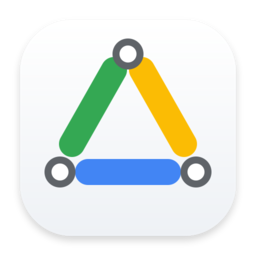

<p align="center">
  
</p>

<h1 align="center">Drivux</h1>

<p align="center">
  A simple Google Drive client for Linux. It mounts Drive as a disk and keeps your folders in two-way sync.<br>
  Built with GTK 4 and libadwaita, powered by <a href="https://rclone.org">rclone</a>.
</p>

<p align="center">
  <b>English</b> · <a href="README.tr.md">Türkçe</a> · <a href="https://abdullahnil.github.io/drivux/">Website</a>
</p>

---

## What it does

Drivux does two things, and you can use either one or both:

1. **Mounts Google Drive as a disk.** Your whole Drive shows up in the Files sidebar as "Google Drive". Files are downloaded when you open them, so they don't fill up your disk.
2. **Syncs folders in both directions.** The folders you choose stay on your computer and open without an internet connection. Changes on either side are copied to the other side.

## Features

- **Setup wizard.** On first launch a wizard walks you through every step:
  - installs rclone
  - connects your Google account, optionally with your own client ID
  - asks where to mount the disk and how big the cache can get
  - lets you pick the folders to sync
- **Installs rclone for you.** If rclone is missing or too old, the wizard downloads the latest release from the official site. It checks the file against rclone's SHA256 checksums and installs it for your user only, so it needs no root access.
- **Google Docs support.** Docs, Sheets and Slides show up on the disk as small shortcut files. Double-click one and it opens in Google's own editor in your browser.
- **Status at a glance.** One window shows the overall status, the synced folders and when each was last synced.
- **Full storage picture.** Your Google storage is shared by Drive, Gmail and Google Photos. Drivux shows the total and how much each one uses, so the numbers match what Google shows you.
- **Top bar icon.** See the sync status at a glance, and sync now, open Drivux or open your Drive from the top bar. You can turn it off in Settings.
- **Built-in updates.** Drivux checks for a new release once a day and shows a banner when one is out. One click downloads and installs it: the .rpm or .deb package if you installed a package, or the source release if you installed from source. You can also use *Check for updates* in the menu, or turn the daily check off in Settings.
- **English and Turkish.** The interface follows your system language. You can also pick a language in Settings.
- **Automatic sync.** A change in a synced folder is uploaded within about 15 seconds. Drivux also syncs on a regular schedule, every 5 minutes by default.
- **Error notifications.** When something goes wrong you get a desktop notification. The details are in the log viewer.
- **Protection against mass deletion.** If a single sync would delete more than 50 files, it stops and waits for your confirmation.
- **No data loss on conflicts.** If the same file changes on both sides, the newer version wins and the other one is kept as a numbered copy.
- **Starts with your session.** The disk and the sync both start when you log in.

## Installation

### From a package (recommended)

Download the package for your distribution from the [Releases](https://github.com/abdullahnil/drivux/releases) page:

```bash
# Fedora / RHEL / openSUSE
sudo dnf install ./drivux-1.5.0-1.noarch.rpm

# Ubuntu 24.04+ / Debian 13+ / Linux Mint 22+
sudo apt install ./drivux_1.5.0_all.deb
```

Then open **Drivux** from your app menu and the setup wizard starts.

### From source

```bash
git clone https://github.com/abdullahnil/drivux.git
cd drivux
./kur.sh
```

`kur.sh` does three things:

- installs the required system packages with your package manager (dnf, apt, pacman or zypper)
- installs Drivux for your user only, under `~/.local`
- opens the setup wizard

To update, run `git pull` and then `./kur.sh` again. Your settings are kept.

### Requirements

- GTK 4 and **libadwaita 1.5 or newer**. Fedora 40+, Ubuntu 24.04+ and Debian 13+ all qualify.
- FUSE 3, for the disk feature
- For the top bar icon: the AppIndicator library (`libappindicator-gtk3` on Fedora, `gir1.2-ayatanaappindicator3-0.1` on Ubuntu/Debian). On GNOME you also need the [AppIndicator extension](https://extensions.gnome.org/extension/615/appindicator-support/); Ubuntu ships it, and on Fedora it's `gnome-shell-extension-appindicator`.
- A systemd user session

## Usage

Open **Drivux** from your app menu.

From a terminal:

```bash
drivux            # open the app
drivux sync       # sync now
drivux status     # print sync status as JSON
drivux tray       # show the top bar icon
```

## How it works

| Component | Role |
|---|---|
| `drivux-disk.service` | Mounts Drive at `~/Google Drive` with `rclone mount`, using the full VFS cache. |
| `drivux.service` | A Python service that syncs folders with `rclone bisync`. It watches the folders for changes and runs the schedule. |
| `drivux` | The GTK 4 / libadwaita app and setup wizard. It talks to the service through the settings and status files and Unix signals. |

| What | Where |
|---|---|
| Settings | `~/.config/drivux/ayar.json` |
| Status | `~/.local/state/drivux/durum.json` |
| rclone (if Drivux installed it) | `~/.local/share/drivux/bin/rclone` |
| Logs | `journalctl --user -u drivux -u drivux-disk` |

### Building packages

```bash
./paketleme/paketle.sh   # writes the .rpm and .deb to dist/
```

This needs `rpmbuild` and `dpkg-deb`. On Fedora, install them with `sudo dnf install rpm-build dpkg`.

### Translations

The interface is written in English, and translations live in `drivux/ceviri_<language>.py` as a dictionary keyed by the English text. Turkish is in `drivux/ceviri_tr.py`. To add a language:

1. Copy `drivux/ceviri_tr.py` to `drivux/ceviri_<code>.py` and translate the values.
2. Register it in `DILLER` and `DIL_ADLARI` in `drivux/ceviri.py`.
3. Run `python3 paketleme/ceviri-kontrol.py`. It reports missing translations and mismatched `{placeholders}`, and the package build runs it too.

## Good to know

- **Sync is a mirror, not a backup.** If you delete or damage a file, that change goes to Drive as well. Files deleted from Drive stay in Drive's trash for 30 days.
- **Thumbnails download files.** The file manager treats the Drive disk like a local disk, so it downloads photos, videos and PDFs (up to 50 MB by default) to make thumbnails the first time you open a folder. After that they come from the cache. On a slow connection you can lower the limit with `gsettings set org.gnome.nautilus.preferences thumbnail-limit 10` (in MB), or turn thumbnails off in Files → Preferences.
- **Google Docs files only appear on the disk.** They are not part of folder sync, because they are documents on Google's servers, not real files.
- **Use your own client ID.** The Google client ID that rclone shares with all its users is being retired. To avoid losing access, turn on "Kendi Google client ID'ni kullan" (Use your own Google client ID) in the wizard and enter your own ID. The [rclone guide](https://rclone.org/drive/#making-your-own-client-id) explains how to create one.
- **Upgrading from an older name.** Drivux was called "Drive Bağlantı" up to 1.1 and "G-Drivux" in 1.2. The first time you run Drivux, your settings, sync state and downloaded rclone move to the new names automatically, and the old services are turned off.

## Uninstalling

```bash
./kaldir.sh                  # if you installed from source
sudo dnf remove drivux      # Fedora
sudo apt remove drivux      # Ubuntu / Debian
```

None of these touch your files on the computer or on Drive.

## License

[MIT](LICENSE). Drivux is not affiliated with or endorsed by Google. Google Drive is a trademark of Google LLC.
