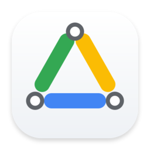

<p align="center">
  
</p>

<h1 align="center">G-Drivux</h1>

<p align="center">
  Linux için sade bir Google Drive istemcisi. Drive'ı disk olarak bağlar ve klasörlerini iki yönlü eşitler.<br>
  GTK 4 ve libadwaita ile yazıldı, arka planda <a href="https://rclone.org">rclone</a> ile çalışır.
</p>

<p align="center">
  <a href="README.md">English</a> · <b>Türkçe</b>
</p>

---

## Ne yapar?

G-Drivux iki iş yapar. İkisini birlikte de kullanabilirsin, yalnızca birini de:

1. **Google Drive'ı disk olarak bağlar.** Drive'ın tamamı Dosyalar'ın kenar çubuğunda "Google Drive" olarak görünür. Dosyalar açtıkça indirilir, bu yüzden diskini doldurmaz.
2. **Klasörleri iki yönlü eşitler.** Seçtiğin klasörler bilgisayarında da durur ve internet olmadan da açılır. Bir tarafta yapılan değişiklik öbür tarafa aktarılır.

## Özellikler

- **Kurulum sihirbazı.** İlk açılışta seni adım adım yönlendirir:
  - rclone'u kurar
  - Google hesabını bağlar; istersen kendi client ID'ni de kullanabilirsin
  - diskin nereye bağlanacağını ve önbelleğin ne kadar büyüyebileceğini sorar
  - eşitlenecek klasörleri seçtirir
- **rclone'u senin yerine kurar.** rclone kurulu değilse ya da çok eskiyse sihirbaz güncel sürümü resmi siteden indirir. Dosyayı rclone'un yayımladığı SHA256 özetleriyle doğrular ve yalnızca senin kullanıcın için kurar, yönetici yetkisi gerekmez.
- **Google Docs desteği.** Dokümanlar, E-Tablolar ve Slaytlar diskte küçük kısayol dosyaları olarak görünür. Birine çift tıklayınca tarayıcıda Google'ın kendi düzenleyicisinde açılır.
- **Durum tek bakışta.** Tek pencerede genel durum, Drive'da kullanılan alan, eşitlenen klasörler ve her birinin son eşitleme zamanı görünür.
- **Otomatik eşitleme.** Eşitlenen bir klasördeki değişiklik yaklaşık 15 saniye içinde yüklenir. G-Drivux ayrıca düzenli aralıklarla da eşitler, varsayılan olarak 5 dakikada bir.
- **Hata bildirimleri.** Bir şey ters giderse masaüstü bildirimi alırsın. Ayrıntılar kayıt görüntüleyicide.
- **Toplu silmeye karşı koruma.** Tek bir eşitleme 50'den fazla dosya silecekse eşitleme durur ve senin onayını bekler.
- **Çakışmada veri kaybı yok.** Aynı dosya iki tarafta birden değişirse yeni sürüm kalır, öbürü numaralı bir kopya olarak saklanır.
- **Oturumla birlikte başlar.** Hem disk hem eşitleme oturum açtığında kendiliğinden başlar.

## Kurulum

### Paketle (önerilen)

Dağıtımına uygun paketi [Sürümler](https://github.com/abdullahnil/gdrivux/releases) sayfasından indir:

```bash
# Fedora / RHEL / openSUSE
sudo dnf install ./gdrivux-1.2.0-1.noarch.rpm

# Ubuntu 24.04+ / Debian 13+ / Linux Mint 22+
sudo apt install ./gdrivux_1.2.0_all.deb
```

Ardından uygulama menüsünden **G-Drivux**'u aç; kurulum sihirbazı başlar.

### Kaynaktan

```bash
git clone https://github.com/abdullahnil/gdrivux.git
cd gdrivux
./kur.sh
```

`kur.sh` üç iş yapar:

- gerekli sistem paketlerini paket yöneticinle kurar (dnf, apt, pacman ya da zypper)
- G-Drivux'u yalnızca senin kullanıcın için `~/.local` altına kurar
- kurulum sihirbazını açar

Güncellemek için `git pull` yapıp `./kur.sh`'i yeniden çalıştır. Ayarların korunur.

### Gereksinimler

- GTK 4 ve **libadwaita 1.5 ya da daha yenisi**. Fedora 40+, Ubuntu 24.04+ ve Debian 13+ bu koşulu karşılar.
- FUSE 3 (disk özelliği için)
- systemd kullanıcı oturumu

## Kullanım

Uygulama menüsünden **G-Drivux**'u aç.

Terminalden:

```bash
gdrivux            # uygulamayı aç
gdrivux esitle     # hemen eşitle
gdrivux durum      # eşitleme durumunu JSON olarak yazdır
```

## Nasıl çalışır?

| Parça | Görevi |
|---|---|
| `gdrivux-disk.service` | `rclone mount` ile Drive'ı `~/Google Drive` klasörüne bağlar. Tam VFS önbelleğini kullanır. |
| `gdrivux.service` | Klasörleri `rclone bisync` ile eşitleyen Python servisi. Klasörlerdeki değişiklikleri izler ve zamanlamayı yürütür. |
| `gdrivux` | GTK 4 / libadwaita uygulaması ve kurulum sihirbazı. Servisle ayar ve durum dosyaları ile Unix sinyalleri üzerinden haberleşir. |

| Ne | Nerede |
|---|---|
| Ayarlar | `~/.config/gdrivux/ayar.json` |
| Durum | `~/.local/state/gdrivux/durum.json` |
| rclone (G-Drivux kurduysa) | `~/.local/share/gdrivux/bin/rclone` |
| Kayıtlar | `journalctl --user -u gdrivux -u gdrivux-disk` |

### Paket üretmek

```bash
./paketleme/paketle.sh   # .rpm ve .deb dosyalarını dist/ klasörüne yazar
```

Bunun için `rpmbuild` ve `dpkg-deb` gerekir. Fedora'da `sudo dnf install rpm-build dpkg` ile kurabilirsin.

## Bilinmesi gerekenler

- **Eşitleme bir yedek değil, aynadır.** Bir dosyayı silersen ya da bozarsan bu değişiklik Drive'a da gider. Drive'dan silinen dosyalar 30 gün boyunca Drive'ın çöp kutusunda durur.
- **Google Docs dosyaları yalnızca diskte görünür.** Klasör eşitlemesine dahil değildir, çünkü bunlar gerçek dosya değil, Google'ın sunucularındaki belgelerdir.
- **Kendi client ID'ni kullan.** rclone'un bütün kullanıcılarıyla paylaştığı Google client ID'si kullanımdan kaldırılıyor. Erişimini kaybetmemek için sihirbazda "Kendi Google client ID'ni kullan" seçeneğini aç ve kendi ID'ni gir. Nasıl oluşturulacağını [rclone rehberi](https://rclone.org/drive/#making-your-own-client-id) anlatıyor.
- **"Drive Bağlantı"dan (1.1 ve öncesi) yükseltme.** G-Drivux'un eski adı Drive Bağlantı'ydı. G-Drivux'u ilk çalıştırdığında ayarların, eşitleme durumun ve indirilmiş rclone yeni adlara kendiliğinden taşınır, eski servisler de kapatılır.

## Kaldırma

```bash
./kaldir.sh                  # kaynaktan kurduysan
sudo dnf remove gdrivux      # Fedora
sudo apt remove gdrivux      # Ubuntu / Debian
```

Bunların hiçbiri bilgisayardaki ya da Drive'daki dosyalarına dokunmaz.

## Lisans

[MIT](LICENSE). G-Drivux'un Google ile bir bağlantısı yoktur ve Google tarafından onaylanmamıştır. Google Drive, Google LLC'nin ticari markasıdır.
